<picture>
  <source media="(prefers-color-scheme: dark)" srcset="kleos/D01-orbit-dark.svg">
  
</picture>

<picture>
  <source media="(prefers-color-scheme: dark)" srcset="kleos/A05-ecosystem-rollup-dark.svg">
  
</picture>
